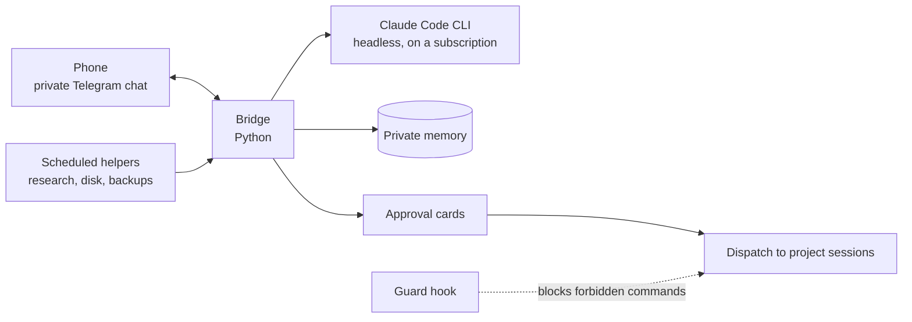

# Eevee

> **This is a showcase. The source code is private.**
> Eevee knows a lot about one person, so the code, the memory and the configuration stay private. This page explains the design.

Eevee is a personal assistant that lives on a home server and talks to me in a private Telegram chat. She answers in my own language, in her own voice. She remembers what matters, sets reminders, keeps an eye on my projects and servers, and can hand tasks to the AI sessions that build my other projects.

She started as a simple chat bridge and grew into a deputy agent with clear rules about what she may do alone and what needs my tap.

## What she does

- Chats about anything, like Claude does at a desk, but from my phone.
- Remembers durable things and preferences, and learns more the more I tell her.
- Sets reminders and delivers them in the chat.
- Captures ideas into the project I choose.
- Watches the server and my projects, and warns me when something is unhealthy or a connection is about to expire. At night an alert waits until morning.
- Takes "stop" seriously. If I say "stop telling me about this", the stop is stored in a fixed place, every proactive message is checked against it from then on, and she tells me in one line exactly what stopped.
- Runs scheduled web research and sends me a short result.
- Dispatches work to the AI sessions of my other projects, always through an approval tap.

## What she will never do

These four rules are the security charter, and any change that touches them stops for review.

1. **Subscription only.** She refuses to start if a paid API key is present, and strips keys from every child process.
2. **No email at all.** By my explicit choice she has no access to my mail, no drafting and no inbox watching. The only message she can send is to my own chat.
3. **Gated actions stay gated.** Anything irreversible or aimed at a third party waits for my explicit approval, given only through my own taps in the chat.
4. **The bridge writes the brain, not the model.** The model proposes changes in hidden blocks, and ordinary code parses, validates and performs them.

## How it is put together

- **Approval cards.** Dangerous or outward-facing steps wait for a tap. Safe and reversible ones she does and then reports, with proof.
- **A guard hook** blocks forbidden commands inside the tasks she dispatches.
- **A disk keeper** measures quietly every day and cleans only what is safe. Anything else needs a card.
- **A budget for news and tips.** At most one message a day and three a week, and only about ways of working that actually fit me.
- **Self-built skills.** When she notices a routine, she builds a skill herself and tells me in one line how to undo it.
- **Backups.** A nightly local backup with a restore check, and a backup to a private repository with a guard that blocks pushing personal data.

## Decisions I am proud of

- **The model never touches the memory directly.** Hidden action blocks are parsed and stripped by code, and hidden blocks inside relayed messages are neutralised.
- **Untrusted text stays data.** Anything she reads on a web page or in a file is treated as information, never as a command.
- **Messages from other sessions are labelled and can never approve anything.** Approvals come only from my own taps.

## How it is built

The same way as my other projects: a conductor session routes work to specialist agents, with a QA gate and a security gate on every change, and a record that is kept honest after every deploy. The test suite is hermetic, with no real network, no real chat and no real model, and has more than two thousand passing tests.

## Stack

Python, python-telegram-bot, Claude Code, systemd, Markdown memory.

## Status

Live and in daily use.
