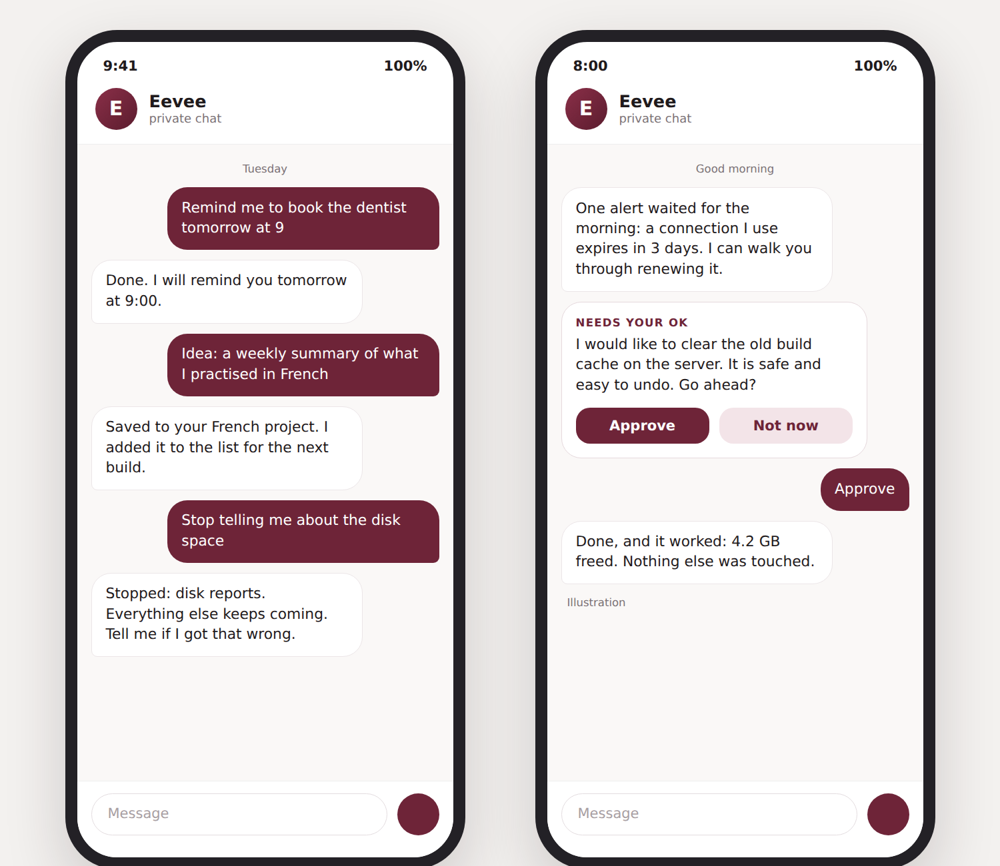

<h1 align="center">Eevee</h1>

<b>A personal assistant that lives in my Telegram, and knows exactly what she is not allowed to do.</b>

> **This is a showcase.** The source code is private, because Eevee knows a lot about one person. Here is what she does and how her limits work.

Eevee talks to me in a private Telegram chat, in my own language and in her own voice. She started as a simple chat bridge. Over time she turned into something closer to a deputy: she keeps track of things, watches my servers and projects, and passes work to the AI sessions that build my other apps.

## A look

An illustration of how Eevee talks: a mockup, not a real conversation. A reminder, an idea caught on the fly, a "stop" that really stops, and a card for anything that needs my OK.

## What she does

- **Chats about anything,** like having Claude at my desk, but in my pocket.
- **Remembers** preferences, people and plans. The more I tell her, the better she knows me.
- **Reminds me** when I asked her to.
- **Files my ideas** into the right project when I toss one into the chat.
- **Watches** my servers and projects, and warns me when something is unhealthy or a connection is about to expire. If it happens at night, the alert waits until morning.
- **Researches** on a schedule I set, and sends a short summary.
- **Gets work moving** by handing a task to the AI sessions that build my other projects, always through an approval card.

## Her limits are the point

- **She cannot read my email.** I took that away on purpose, and she has no way to get it back on her own. The only message she can ever send is to me.
- **Anything risky or permanent comes as a card** with two buttons, Approve and Not now. Safe and reversible things she just does, and then tells me what she did.
- **"Stop" means stop.** If I say "stop telling me about this", the stop is stored, everything she sends afterwards is checked against it, and she tells me in one line exactly what stopped, so I can correct her if she misunderstood.
- **She cannot surprise me with a bill.** She only ever runs on the plan I already pay for.
- **She suggests, the system acts.** She can propose a change to her own memory, but ordinary, tested code decides what actually gets written.

## Quiet by design

At most one news or tip message a day, and only about ways of working that really fit me. A nightly backup comes with a restore check, so I know it really works.

## How I built her

The same way as my other projects: a team of AI agents, a human in the loop, and a quality check and a security check on every change. More than two thousand automated tests keep her honest, and none of them touches a real chat, a real network or a real model.

## Want to see how she works?

The code stays private, but I am happy to walk you through her design, live.

Built by <a href="https://github.com/einavtayari">Einav</a>, the human in the loop.

